<div align="center">


# Dragon — 开源项目 Issue 到 Release 全自动 SDLC 桌面工作台

**让开源仓库维护彻底告别繁琐重复劳动：从 GitHub Issue 自动拉取、多 AI Coding Agent 智能调度、隔离分支开发与测试自愈，到 PR 提交、CI 盯守与 SemVer 发版列车，一站式全自动完成。**

[](https://backbay2-yzg.github.io/dragon-sdlc/)
[](https://go.dev/)
[](https://v3.wails.io/)
[](https://react.dev/)
[](https://react.fluentui.dev/)
[](https://learn.microsoft.com/windows/apps/design/style/mica)

[🌐 在线文档官网](https://backbay2-yzg.github.io/dragon-sdlc/) · [核心亮点](#-核心亮点) · [零基础环境安装](#-零基础环境安装与启动小白必看) · [5分钟快速上手](#-小白-5-步快速上手教程) · [全功能图文详解](#-全功能图文详解) · [项目架构](#-项目架构与目录说明) · [常见问题](#-小白常见问题排查-faq)

</div>

---

## 📖 Dragon 是什么？

假设你维护着一个 GitHub 开源仓库（或者自己的个人项目），每天都要经历这样一套固定流程：
> 看新 Issue → 理解需求写方案 → 切新 Git 分支 → 改代码、跑测试、自己修报错 → 自查 Code Review → 推分支提 PR → 盯 GitHub Actions CI → 合并 PR → 计算版本号写 Changelog 发 Release。

**Dragon 就是把上面整套流程“装进一个 Windows 11 原生桌面软件里”的自动化中控台**：
- **不用学复杂命令行**：所有仓库、Issue、AI 代理、流水线日志、代码 Diff、人工审批与发版都在可视化界面点几下鼠标完成。
- **不绑死任何一家 AI**：自动扫描你电脑上已安装的 Coding Agent CLI（如 Claude Code、OpenAI Codex、Gemini CLI、Qoder CLI、WorkBuddy、Antigravity CLI、OpenCode、Aider 等），还能**不同阶段混用不同 Agent 和模型**（例如 Claude 做架构设计、Codex 写代码跑测试、Gemini 做独立代码审查）。
- **绝不弄乱你本地正在写的代码**：每次任务都会在独立目录 `.dragon-worktrees` 中创建隔离的 `git worktree` 分支干活，干完还能一键清理。
- **可控可暂停，绝不乱合并代码**：默认开启“人工审批门禁”，重要节点会弹窗并发送 Windows 原生通知请你审阅 Diff 后点击“批准并继续”，不满意还可以打回并附上修改意见让 AI 重做。

<div align="center">
  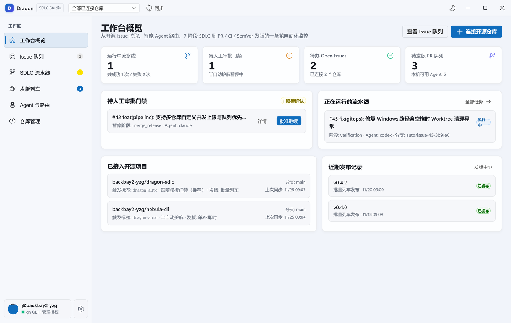
  <br />
  <sub>▲ 工作台概览（浅色云母模式）：一眼掌握运行中流水线、待审批门禁、待办 Issue、待发版队列与已接入仓库</sub>
</div>

<br />

<div align="center">
  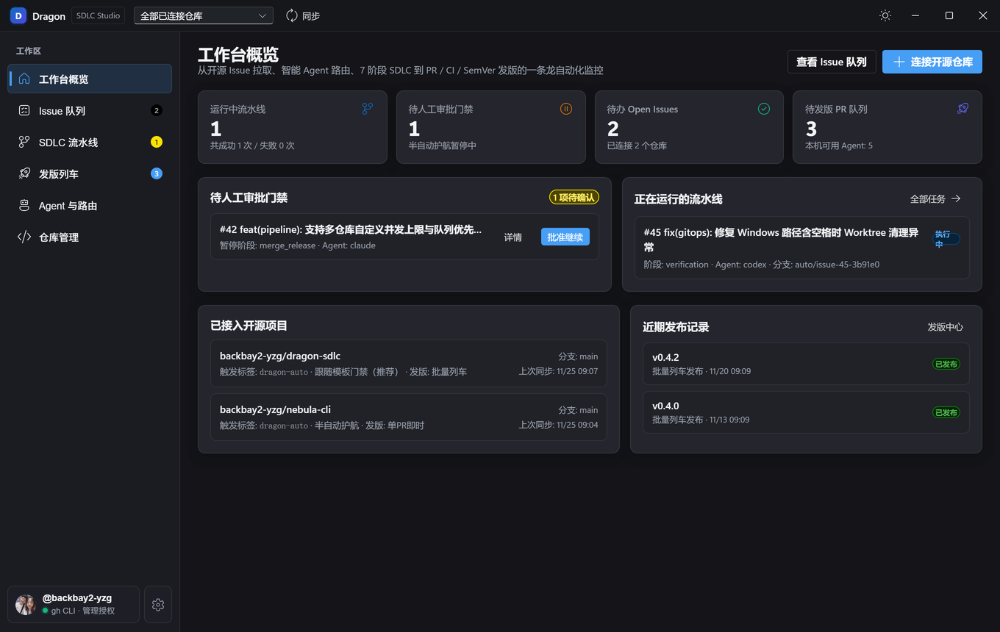
  <br />
  <sub>▲ 一键切换深色模式（支持 Mica / Mica Alt / Acrylic 三种 Windows 11 原生窗口材质）</sub>
</div>

---

## 🔄 端到端全自动工作流（一图看懂）

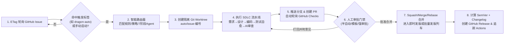

---

## ✨ 核心亮点

| 能力维度 | 具体实现与小白友好价值 |
| :--- | :--- |
| **零配额 ETag 轮询** | 使用 GitHub `If-None-Match` 条件请求，仓库无新变化返回 `304 Not Modified`，**不消耗 API 配额**；支持设置任意触发标签（默认 `dragon-auto`）。 |
| **15+ Agent 自动发现** | 开箱内置 **15 款主流 Coding CLI**（含对 Windows 商店版 Codex 桌面端、WorkBuddy 桌面端内嵌 CLI 的自动注册表探测），有原生登录态即可直接免配置使用。 |
| **9 大模型供应商 + 自定义** | 内置 Anthropic、OpenAI、Google Gemini、DeepSeek、Moonshot/Kimi、智谱 GLM、通义千问 Qwen、MiniMax、OpenRouter，并支持添加本地 Ollama 或任意兼容端点。 |
| **7 阶段可编排 SDLC** | 覆盖 `需求分析 → 方案设计 → 编码实现 → 测试验证 → AI 代码审查 → 提交 PR 与 CI 跟踪 → 合并与发布`，可按「简单修复 4 阶段快车道 / 复杂修复 / 完整功能 / 文档」自动分流。 |
| **测试 & CI 自动自愈** | 本地测试/Lint 报错或 GitHub Actions 检查失败时，自动提取错误日志回传给 Agent 修复重试（可分别配置最大重试次数）。 |
| **Git Worktree 物理隔离** | 每次运行都在仓库同级 `.dragon-worktrees/` 下开启全新工作树，多任务并行（1~6 并发）互不覆盖，完全不污染主工作区。 |
| **SemVer 发版列车** | 合并后的 PR 自动按 Conventional Commits（`feat` / `fix` / `BREAKING`）聚合分类，自动推算 `major / minor / patch` 下一版本号并生成 Markdown Changelog。 |
| **Windows 11 原生安全与体验** | Wails v3 无边框透明窗口 + Mica/Acrylic DWM 材质 + 系统托盘驻留 + Windows Toast 审批通知；**所有 GitHub Token 与模型 API Key 均加密存入 Windows Credential Manager**，绝不落盘明文。 |

---

## 🛠 零基础环境安装与启动（小白必看）

> 如果你是从源码运行或打包 Dragon，只需按顺序准备好下面几个基础工具。**建议全程使用 Windows PowerShell 或 Windows Terminal。**

### 1. 环境依赖清单

| 工具 | 最低要求 | 用途说明 | 如何检查是否已安装 | 安装途径 |
| :--- | :--- | :--- | :--- | :--- |
| **Git** | 2.30+ | 创建隔离 Worktree、提交分支代码 | `git --version` | [git-scm.com](https://git-scm.com/downloads/win) |
| **Go** | **1.26+** | 编译 Dragon 后端调度引擎（与 `go.mod` 一致） | `go version` | [go.dev/dl](https://go.dev/dl/) |
| **Node.js** | **20+**（推荐 22） | 构建前端 React + Fluent UI 界面 | `node -v` | [nodejs.org](https://nodejs.org/) |
| **pnpm** | 9+ / 10+ | 安装并构建 `frontend/` 前端依赖 | `pnpm -v` | `npm install -g pnpm` |
| **Wails v3 CLI** | **v3.1.0** | 桌面应用热重载调试与 `.exe` 打包 | `wails3 version` | `go install github.com/wailsapp/wails/v3/cmd/wails3@v3.1.0` |
| **GitHub CLI (`gh`)** | 可选（强烈推荐） | 1 秒自动登录 GitHub（也可用 PAT 替代） | `gh --version` | [cli.github.com](https://cli.github.com/) |
| **AI Coding CLI** | 至少安装 1 款 | 实际执行写代码/审代码的 AI 工具 | 例如 `claude --version` 或 `codex --version` | 见软件内「Agent 与路由 → 安装指引」 |

> **提示**：Windows 11 系统已自带 Edge WebView2 运行时；如果是 Windows 10，若启动时报缺少 WebView2，从[微软官网下载常青版引导程序](https://developer.microsoft.com/microsoft-edge/webview2/)安装即可。

### 2. 下载源码并启动运行

打开 PowerShell，依次执行以下 4 步：

```powershell
# 第 1 步：克隆本项目到本地
git clone https://github.com/backbay2-yzg/dragon-sdlc.git
cd dragon-sdlc

# 第 2 步：安装前端依赖并生成 Wails TypeScript 绑定
pnpm --dir frontend install

# 第 3 步（方式 A）：开发模式启动（修改前端/后端会自动热更新，适合边看边试）
wails3 task dev PACKAGE_MANAGER=pnpm

# 第 3 步（方式 B）：直接编译正式版单文件 dragon.exe（产物在 bin\dragon.exe）
wails3 task build PACKAGE_MANAGER=pnpm
```

编译完成后，直接双击 `D:\Dragon\bin\dragon.exe`（或你所在目录的 `bin\dragon.exe`）就能看到 Dragon 窗口了！

如果想验证后端单元测试是否全部通过，可以运行：

```powershell
go test ./...
```

---

## 🚀 小白 5 步快速上手教程

第一次打开 Dragon，你只需要按照下面 **5 个步骤**操作，**5 分钟内**就能跑通第一条全自动 Issue → PR 流水线！

### 第 1 步：连接你的 GitHub 账号（3 种方式任选其一）

点击界面**左下角的 GitHub 账号卡片**（未登录时显示「未连接 GitHub · 点击授权登录」），会弹出授权窗口：

<div align="center">
  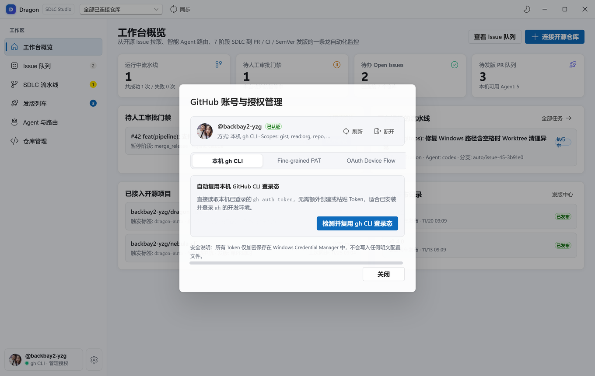
</div>

根据你的习惯选择其中 **任意一种**：
1. **方式一：本机 `gh CLI`（最省心，小白首选）**
   - 如果你平时在终端登录过 `gh auth login`，直接点 **「检测并复用 gh CLI 登录态」**，1 秒完成绑定。
2. **方式二：Fine-grained PAT（精细权限个人令牌，无需装 `gh`）**
   - 前往 GitHub 网页：`Settings → Developer settings → Personal access tokens → Fine-grained tokens → Generate new token`。
   - 选择要授权的仓库，并勾选 4 个权限：**`Contents` (Read and write)**、**`Issues` (Read and write)**、**`Pull requests` (Read and write)**、**`Actions` (Read-only)**。
   - 复制生成的 `github_pat_...` 粘贴到输入框，点击 **「保存并验证」**。
3. **方式三：OAuth Device Flow 网页授权**
   - 输入你自己的 GitHub OAuth App Client ID（需在 GitHub App 设置中勾选 Enable Device Flow），点击 **「发起授权」**，Dragon 会自动打开浏览器并轮询等待确认。

> 🔒 **安全性说明**：Dragon 不会把你的 Token 写进任何文本文件或代码目录，所有凭据全部加密保存在 **Windows Credential Manager（Windows 凭据管理器）** 中。

---

### 第 2 步：检查本地可用的 AI Coding Agent（选配模型供应商）

点击左侧导航栏 **「Agent 与路由」**：

<div align="center">
  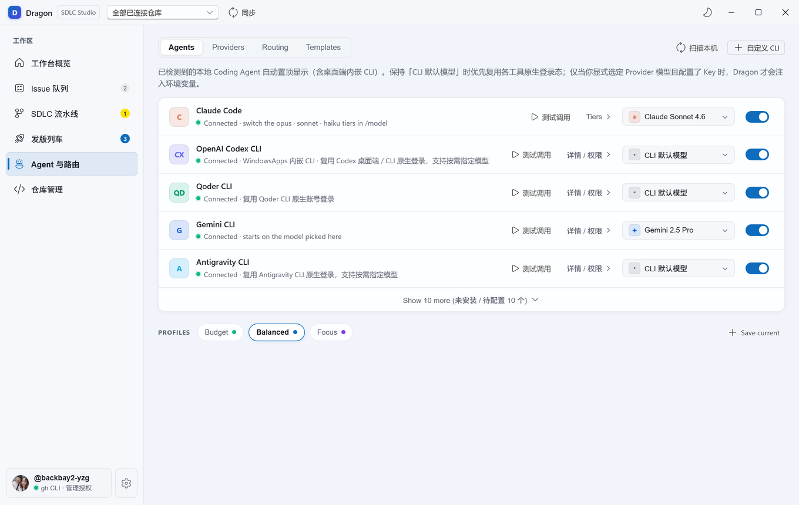
</div>

1. Dragon 启动时会自动扫描你电脑上已经装好的 AI Coding CLI，并把状态为绿色 `Connected` 的工具**自动置顶**。
2. 如果你平时已经在终端登录过（比如运行过 `claude`、`codex login`、`qodercli login`、`gemini` 或 `agy`），**右侧模型下拉框保持默认（或「CLI 默认模型」）即可直接点「测试调用」验证是否连通**。
3. 如果想给某个 Agent 指定第三方中转或国内大模型 API（如 DeepSeek、Kimi、智谱 GLM、通义千问等），切换到上方 **「Providers」** 标签页：

<div align="center">
  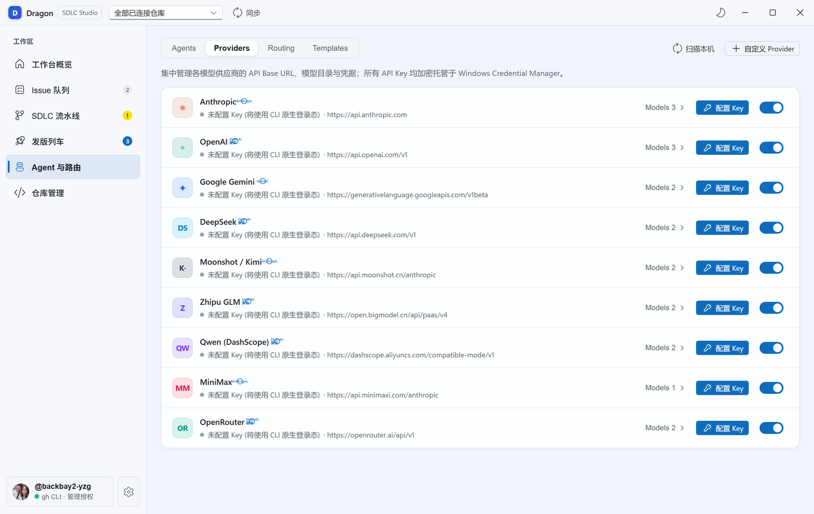
</div>

   - 找到对应供应商点击 **「配置 Key」**，填入 API Key 加密保存；
   - 回到 **「Agents」** 标签页，在右侧药丸下拉框选中该供应商的模型即可生效！
   - 遇到未安装的工具，点击底部 `Show X more` 展开，点 **「安装指引」** 即可一键复制安装命令与登录命令。

---

### 第 3 步：设置默认工作区根目录并接入开源仓库

建议先点击左下角**小齿轮图标（系统设置）**，设置一个统一的 **「默认工作区根目录」**（例如 `D:\DragonWorkspaces`），这样以后每次接入新仓库都会自动帮你算好本地目录，不用手填！

<div align="center">
  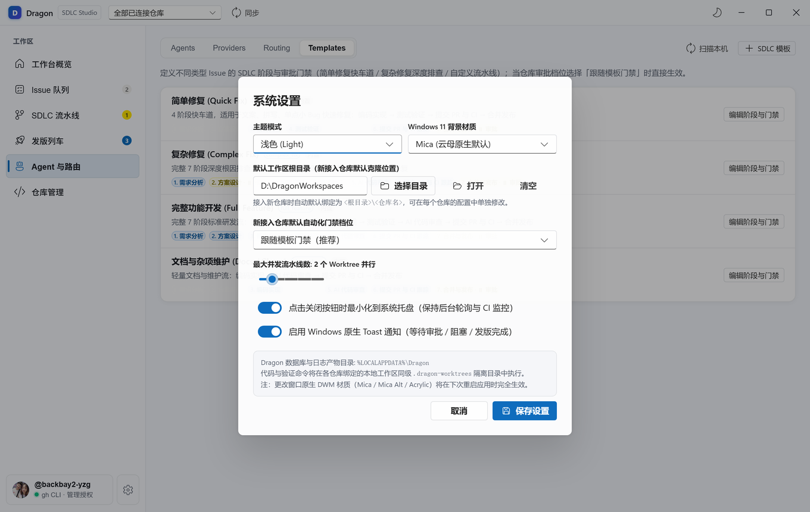
</div>

接着点击左侧 **「仓库管理」** → 右上角 **「+ 接入仓库」**：
- 可以直接从你的 GitHub 账号列表里**勾选多个个人或组织仓库一键批量接入**；
- 也可以切换到 **「手动输入」** 粘贴外部开源仓库地址（如 `owner/repo`）。

<div align="center">
  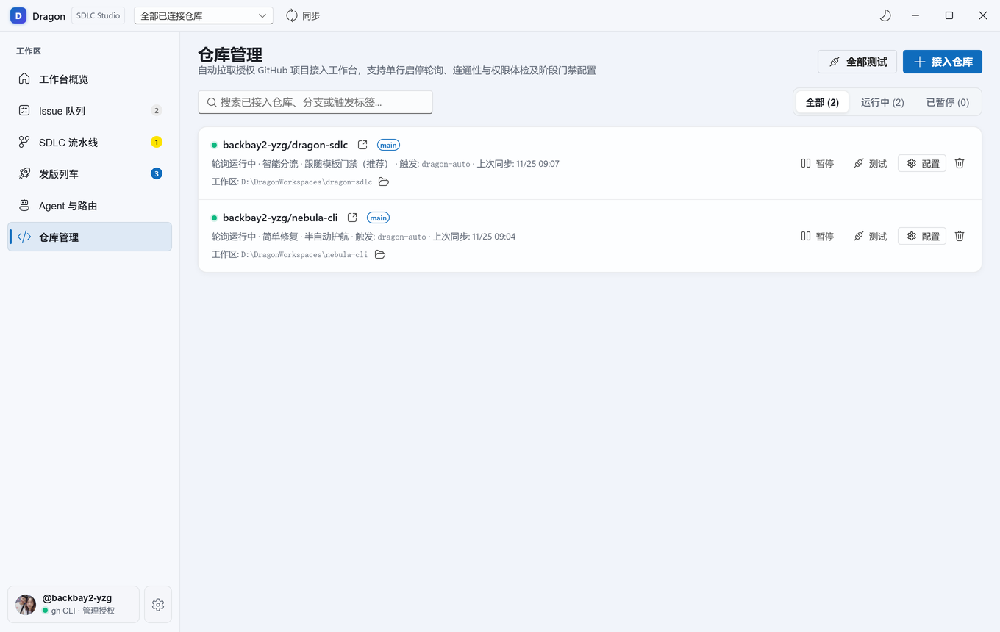
</div>

---

### 第 4 步：配置仓库的工作区、审批门禁与测试命令

在仓库列表某一行右侧点击 **「配置」**，打开「配置仓库」弹窗：

<div align="center">
  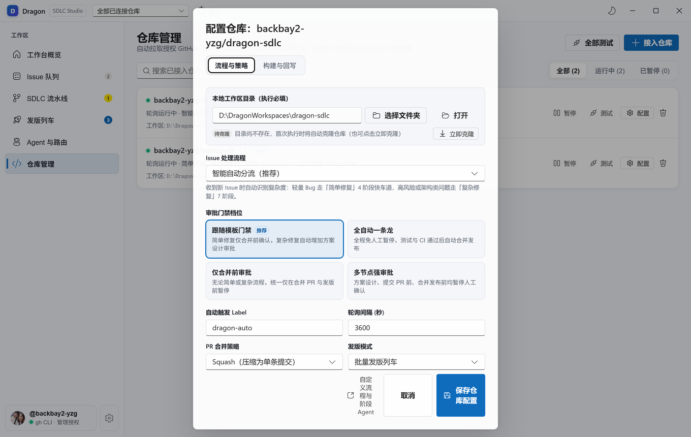
</div>

小白建议重点关注这 4 项（其余保持默认即可）：
1. **本地工作区目录（执行必填）**：
   - 如果本地还没有这个仓库的代码，填一个空路径（或点「使用默认路径」），然后点右侧 **「立即克隆」**（或者先留着，首次运行流水线时也会自动克隆）。
   - 如果你电脑里本来就克隆过这个仓库，点 **「选择文件夹」** 直接选中它即可，Dragon 会校验远端地址是否匹配。
2. **Issue 处理流程**：推荐保持 **「智能自动分流（推荐）」** —— 小 Bug 自动走 4 阶段快车道，大功能或复杂问题自动走 7 阶段完整研发流。
3. **审批门禁档位**：推荐新手选择 **「跟随模板门禁」** 或 **「仅合并前审批」** —— AI 写完代码、跑完测试、提完 PR 后会停下来等你点确认，**绝不会未经允许自动把代码合进 `main`**。
4. **构建与回写（弹窗上方第二个标签页）**：
   - 填入你的项目构建/测试命令（例如 Go 项目填 `go build ./...` 和 `go test ./...`，Node 项目填 `pnpm build` 和 `pnpm test`），Dragon 在第 4 阶段会自动运行这些命令，失败时还会自己读报错日志修代码！

---

### 第 5 步：启动一条自动化流水线、审阅 Diff 并完成合并发版

切换到左侧 **「Issue 队列」**：

<div align="center">
  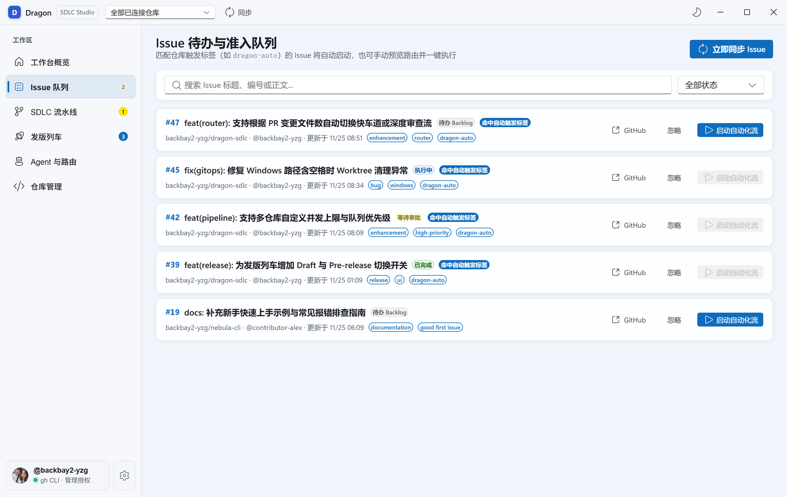
</div>

触发流水线有 **两种方式**：
- **自动触发**：只要某个 GitHub Issue 贴上了你在仓库里配置的触发标签（默认 `dragon-auto`），Dragon 后台同步发现后就会自动入队开跑！
- **手动触发**：找到状态为 `待办 Backlog` 的 Issue，点击右侧 **「启动自动化流」**，先看一眼智能路由器推荐的模板和 Agent，确认无误后点 **「确认启动流水线」**：

<div align="center">
  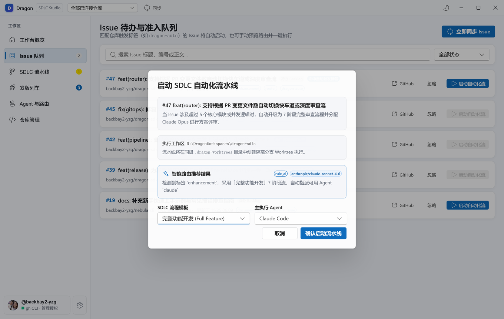
</div>

接着自动跳转到 **「SDLC 流水线」** 页面：

<div align="center">
  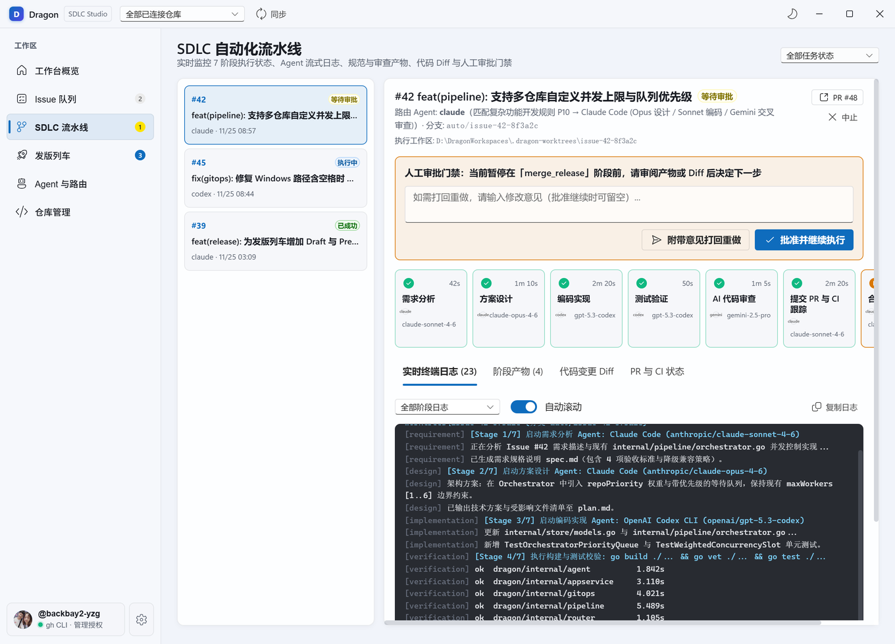
</div>

当流水线跑完代码、通过测试与 AI 审查并提交 PR 后，它会停在黄色提示框 **「人工审批门禁」**。此时你可以：
1. 切到 **「阶段产物」** 查看 AI 写好的 `spec.md`（需求规格）、`plan.md`（设计方案）、`review.md`（跨模型审查报告）：

<div align="center">
  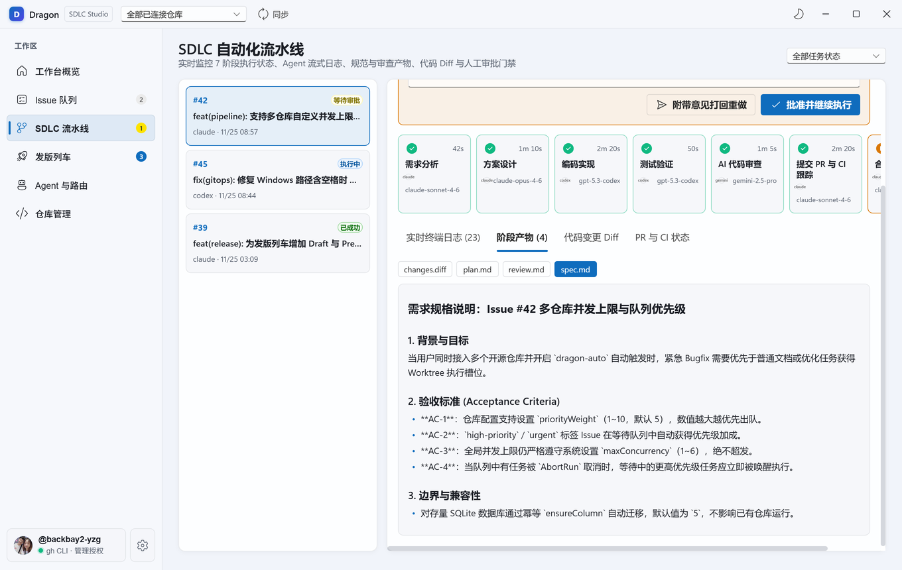
</div>

2. 切到 **「代码变更 Diff」** 按文件逐行核对红绿增删代码：

<div align="center">
  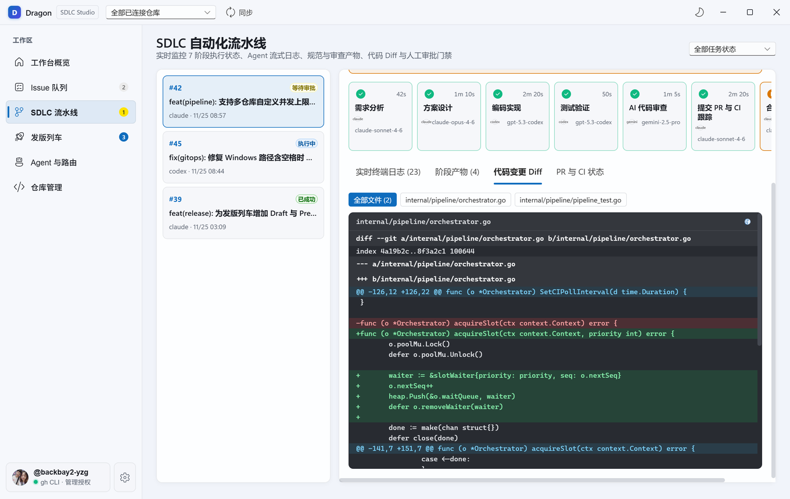
</div>

3. 决定下一步：
   - **觉得不满意**：在黄色输入框里写修改意见（如「请把超时时间改成 10 秒并补一个边界测试」），点 **「附带意见打回重做」**，AI 会带着你的意见重新修改代码并更新 PR；
   - **检查没问题**：点 **「批准并继续执行」**，Dragon 自动按策略合并 PR 并收尾。

4. 最后前往 **「发版列车」**，Dragon 会自动汇总所有已合并但尚未发版的 PR，按 Conventional Commits 规则算好下一版本号和 Changelog，点击 **「发布 GitHub Release」** 即可完成全闭环！

<div align="center">
  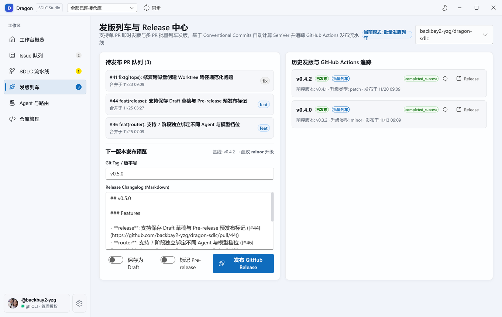
</div>

---

## 📚 全功能图文详解

### 1. 工作台概览与系统托盘

- **4 个顶部实时 KPI 卡片**：支持点击直接跳转到对应功能页（运行中流水线、待人工审批门禁、待办 Open Issues、待发版 PR 队列）。
- **待人工审批门禁快捷区**：不用切进详情页，在首页就能直接点「批准继续」或「详情」。
- **系统托盘后台驻留**：点击右上角关闭按钮默认最小化到 Windows 系统托盘（托盘右键支持「打开主窗口 / 立即同步所有仓库 / 退出 Dragon」），后台持续以低配额 ETag 方式盯守新 Issue 与 CI 状态。
- **Windows 原生 Toast 通知**：流水线暂停等待审批、失败阻塞或发版完成时弹出系统通知，点击通知直接拉起窗口并定位到对应任务。

### 2. 仓库管理与 Git Worktree 物理隔离机制

在「仓库管理」页，你可以：
- 点击 **「全部测试」** 或单行的 **「测试」**，一次性体检 GitHub 连通性、API 延迟、当前 Token 是「可写/PR」还是「仅只读」、默认分支是否有更新，以及本地工作区目录是否就绪。
- 单行点击 **「暂停 / 开始」** 控制某个仓库是否参与后台自动轮询。
- 点击目录旁的文件夹图标直接用资源管理器打开本地代码目录。

**为什么说 Dragon 绝不会搞乱你正在写的代码？**
- 假设你的仓库目录是 `D:\DragonWorkspaces\dragon-sdlc`。
- Dragon 启动任务时，会在同级创建 `D:\DragonWorkspaces\.dragon-worktrees\issue-42-8f3a2c`，并检出独立分支 `auto/issue-42-8f3a2c`。
- 所有 AI 修改代码、运行测试、生成 Diff 全部在这个隔离文件夹中进行；任务完成后，你可以在流水线详情页右上角点击 **「清理工作区」** 释放磁盘（历史 Diff 仍会保存为 `changes.diff` 产物供随时回看）。

### 3. 7 阶段 SDLC 流水线与 4 种门禁档位

Dragon 将标准开源研发流拆解为 **7 个标准阶段**：

| 序号 | 阶段名称 (`stageKey`) | 主要工作内容 | 自动生成的产物 |
| :---: | :--- | :--- | :--- |
| **1** | **需求分析** (`requirement`) | 解析 Issue 描述与代码上下文，拆解验收标准与边界 | `spec.md` |
| **2** | **方案设计** (`design`) | 分析受影响文件、数据结构、接口契约与测试策略 | `plan.md` |
| **3** | **编码实现** (`implementation`) | 在隔离 Git Worktree 中编写实现代码与单元测试 | 代码改动 |
| **4** | **测试验证** (`verification`) | 依次执行仓库配置的 `buildCmd` / `lintCmd` / `testCmd`，**失败时自动携带报错日志打回给 Agent 自愈修复** | 日志与自愈提交 |
| **5** | **AI 代码审查** (`ai_review`) | 提取当前完整 Diff 交给独立审查 Agent 检查缺陷，自动生成报告并修复阻塞项 | `review.md` |
| **6** | **提交 PR 与 CI 跟踪** (`pr_ci`) | Push 分支、自动创建 Pull Request（可向原 Issue 发表评论并同步状态标签），每 15 秒轮询 GitHub Checks；**CI 失败同样支持自动修复并重新推送** | PR & `changes.diff` |
| **7** | **合并与发布** (`merge_release`) | 按仓库策略（Squash / Merge / Rebase）合并 PR，按模式即时发布 Release 或送入批量发版列车 | Release 记录 |

**4 种自动化审批门禁档位对比**：

| 档位 | 说明 | 暂停节点 |
| :--- | :--- | :--- |
| **跟随模板门禁（推荐）** | 智能自适应：简单修复只在合并前确认，复杂修复额外在方案设计后确认 | 由所属模板的 `defaultGates` 决定 |
| **全自动一条龙** | 全程无人值守（适合低风险文档/测试或全托管实验仓库） | **无暂停**（测试 & CI 全绿后自动合并） |
| **仅合并前审批** | 编码与修错全程自动跑，合并到主干前把关一次 | 仅在 **阶段 7（合并与发布）** 前暂停 |
| **多节点强审批** | 关键节点严格人工把关，适合核心生产代码库 | 在 **方案设计**、**提交 PR**、**合并发布** 前均暂停 |

### 4. 智能路由、7 阶段混用矩阵与 Dry-Run 模拟器

切换到 **「Agent 与路由 → Routing」**，你可以精细控制“哪个问题交给谁、哪个阶段用什么模型”：

<div align="center">
  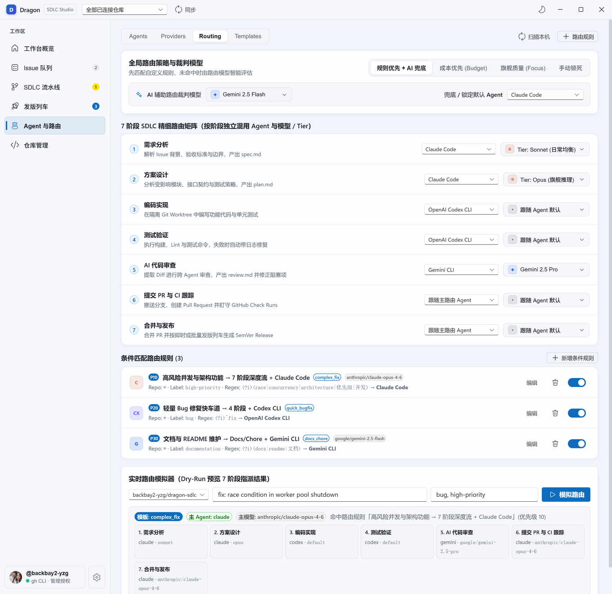
</div>

- **4 种全局路由策略**：
  - `规则优先 + AI 兜底`：先按优先级匹配自定义条件规则；未命中时调用轻量裁判模型（或内置启发式规则）自动判断 Issue 复杂度并指派最合适的 Agent 与流程模板。
  - `成本优先 (Budget)`：优先挑选轻量高速 Agent（如 Codex / Aider / Gemini Flash / Haiku）。
  - `旗舰质量 (Focus)`：优先指派最强推理 Agent 与 Opus / Flagship 模型。
  - `手动锁死`：固定使用你选定的兜底默认 Agent。
- **7 阶段 SDLC 精细路由矩阵**：允许**每个阶段单独指定不同的 Agent 和模型 / Tier**！例如：第 1~2 阶段用 Claude Code (Sonnet/Opus) 出需求与方案，第 3~4 阶段交给 OpenAI Codex CLI 写代码跑测试，第 5 阶段交给 Gemini CLI (`gemini-2.5-pro`) 做独立交叉审查，避免单一模型“自写自审”盲区。
- **条件匹配路由规则**：按优先级（数字越小越先匹配）、适用仓库、Issue Label 与标题正则表达式，把特定 Issue 定向路由到指定模板和 Agent。
- **实时路由模拟器（Dry-Run）**：不用真的启动任务，输入模拟的 Issue 标题和标签点 **「模拟路由」**，立刻预览最终选中的模板、主 Agent 及 7 个阶段各自的分派结果！
- **PROFILES 一键预设快照**（位于 Agents 页底部）：内置 `Budget`（绿色性价比）、`Balanced`（蓝色日常均衡）、`Focus`（紫色旗舰推理）三套预设，点击即刻切换全部 Agent 模型与阶段绑定；你也可以调好自己的组合后点 `+ Save current` 存为个人 Profile。

### 5. SDLC 流水线模板管理

切换到 **「Agent 与路由 → Templates」**，内置 4 套开箱即用的流程模板，也支持点击 **「+ SDLC 模板」** 新增自定义流程：

<div align="center">
  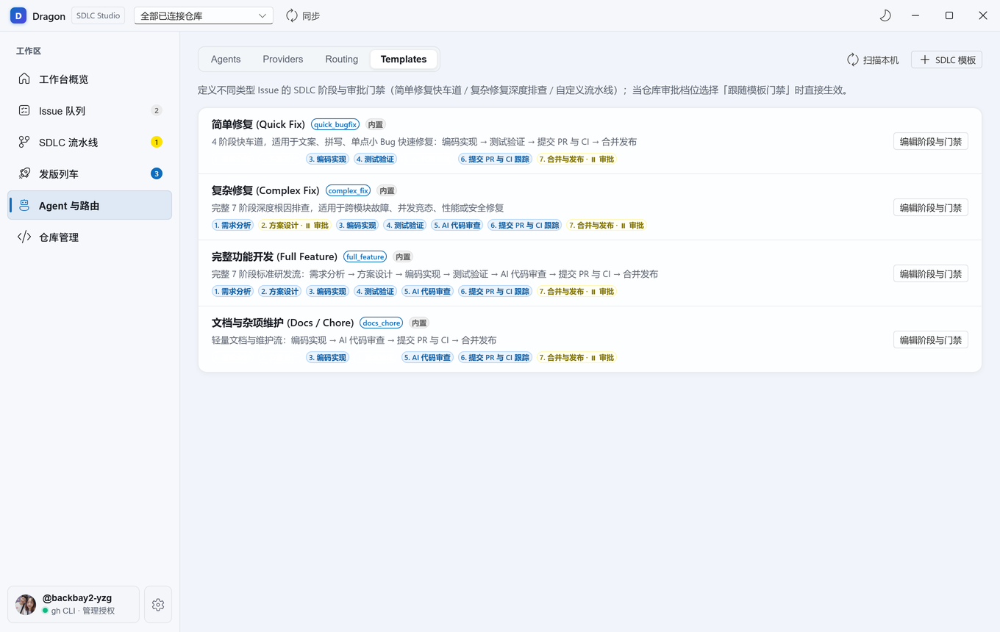
</div>

- **简单修复 (`quick_bugfix`)**：4 阶段快车道（编码实现 → 测试验证 → 提交 PR 与 CI → 合并发布），适合拼写、文案与单点小 Bug。
- **复杂修复 (`complex_fix`)**：完整 7 阶段深度根因排查（默认在「方案设计」和「合并发布」设置双审批门禁）。
- **完整功能开发 (`full_feature`)**：完整 7 阶段标准研发流（默认在「合并发布」前审批）。
- **文档与杂项维护 (`docs_chore`)**：轻量 4 阶段文档流（编码实现 → AI 代码审查 → 提交 PR 与 CI → 合并发布）。

### 6. 发版列车与 SemVer 自动版本管理

进入 **「发版列车」**，Dragon 支持两种仓库级发版模式：
- **单 PR 即时发布 (`immediate`)**：每次流水线成功合并 PR 后立即自动创建对应版本的 GitHub Release。
- **批量发版列车 (`batch`)**：合并后的 PR 先按顺序进入「待发布 PR 队列」，维护者定期打开「发版列车」一次打包发布多个功能与修复。

**SemVer 与 Changelog 自动推算规则**：
- 读取远端最新 Git Tag（如 `v0.4.2`），结合待发布 PR 的 Conventional Commit 标题自动分类：
  - 包含 `BREAKING CHANGE` 或 `feat!:` → 建议 **Major** 升级（`v1.0.0`）；
  - 包含 `feat:` / `feat(scope):` → 建议 **Minor** 升级（`v0.5.0`）；
  - 仅含 `fix:` / `chore:` / `docs:` → 建议 **Patch** 升级（`v0.4.3`）。
- 支持手动微调版本号、编辑 Markdown Changelog、勾选 **「保存为 Draft」** 或 **「标记 Pre-release」**，并在发布后自动追踪 GitHub Actions 对应 tag 的打包流水线状态。

---

## 🏗 项目架构与目录说明

```text
Dragon/
├── main.go                       # Wails v3 桌面入口：窗口 Mica/Acrylic 材质、系统托盘、事件注册
├── assets/                       # 应用与托盘图标资源
├── build/                        # Wails v3 跨平台构建、打包配置 (NSIS / MSIX / Docker)
├── docs/images/                  # README 功能说明截图资源
├── frontend/                     # 前端桌面 UI (React 19 + TypeScript + Fluent UI v9 + Vite 8)
│   ├── bindings/                 # Wails v3 自动生成的 Go -> TypeScript 服务绑定
│   └── src/
│       ├── pages/                # 6 大核心页面 (Dashboard / Issues / Pipelines / Releases / Agents / Repos)
│       ├── components/           # 弹窗、阶段进度条、终端日志、Diff 渲染、模型选择器等组件
│       ├── hooks/useWailsEvents.ts # 监听 Go 后端推送的实时事件总线
│       └── styles/fluent-material.css # Windows 11 Mica/Acrylic 透明材质与 Fluent 2 样式
└── internal/                     # Go 后端核心引擎
    ├── appservice/               # 暴露给前端调用的 Wails Service（Dashboard/Repo/Issue/Pipeline/Agent/Release/Settings）
    ├── config/                   # 路径解析 (%LOCALAPPDATA%\Dragon) 与 AppSettings 持久化配置
    ├── store/                    # 纯 Go SQLite (modernc.org/sqlite WAL 模式) Schema 迁移与查询
    ├── secrets/                  # Windows Credential Manager 凭据加密存储封装
    ├── hosting/github/           # GitHub REST API 客户端（ETag 条件轮询、PR/Check Runs/Release/OAuth Device Flow）
    ├── gitops/                   # Git Worktree 隔离创建/清理、Diff 提取、SemVer 与 Changelog 计算
    ├── agent/                    # 15+ Coding CLI 自动探测（含注册表查 WindowsApps/桌面端内嵌 CLI）、流式执行器与 LLM 客户端
    ├── router/                   # 规则优先 + AI 裁判 + 7 阶段混用路由引擎
    ├── pipeline/                 # 并发受控 (1~6) 的 7 阶段状态机、测试/CI 自愈循环与人工审批门禁
    ├── poller/                   # 后台定时 Issue 同步器与自动入队触发器
    └── release/                  # 发版列车聚合器、GitHub Release 创建与 Actions 状态追踪
```

**前后端实时事件总线（`main.go` 注册）**：
- `dragon:run:updated` — 流水线整体状态变化（入队 / 运行 / 等待审批 / 成功 / 失败 / 中止）
- `dragon:stage:updated` — 7 阶段各节点状态、耗时与产物更新
- `dragon:log:chunk` — Coding Agent 子进程实时 stdout/stderr 流式日志行推送
- `dragon:issues:synced` — 仓库后台轮询同步结果摘要
- `dragon:release:updated` — 发版列车队列与 GitHub Release / Actions 状态刷新
- `dragon:navigate` — 点击 Windows 原生 Toast 通知时跳转定位到对应页面与任务

---

## ❓ 小白常见问题排查 (FAQ)

<details>
<summary><b>1. 为什么在「Issue 队列」点「启动自动化流」提示“尚未配置本地工作区目录”？</b></summary>

Dragon 需要在你电脑上有一个本地 Git 仓库基准目录，才能基于它创建隔离的 `.dragon-worktrees` 分支开展工作。  
**解决办法**：点提示里的「前往配置工作区」（或进入 `仓库管理 → 配置`），填一个你电脑上的空文件夹路径并点「立即克隆」，或者选择你本机已有的该项目目录即可。
</details>

<details>
<summary><b>2. 我明明装了 Claude / Codex / WorkBuddy，为什么页面显示未检测到或测试失败？</b></summary>

- 若显示**未检测到**：请检查该工具是否在系统环境变量 `PATH` 中，或在「Agent 与路由 → 点击某一行『详情 / 权限』」里直接填入可执行文件的完整路径，然后点「扫描本机」。
- 若显示**需要登录**：Dragon 优先复用各 CLI 的原生登录态。请按「详情 / 权限」弹窗里的 **「登录指引」** 在终端执行一次登录命令（如 `codex login`、`qodercli login`、`claude`），或在「Providers」里配置好对应模型的 API Key 并选中该模型。
</details>

<details>
<summary><b>3. Dragon 会不会在我不小心点错时，把 AI 写的半成品直接合并进我的 GitHub 主分支？</b></summary>

**不会。** 默认档位「跟随模板门禁」以及「仅合并前审批」「多节点强审批」都会在合并 PR 前强制暂停并发送通知，**必须等你亲自查看 Diff 后点击「批准并继续执行」**才会触发合并（除非你主动将仓库切换为「全自动一条龙」）。
</details>

<details>
<summary><b>4. 任务正在跑的时候，我自己在原来代码目录里改代码会和 Dragon 冲突吗？</b></summary>

**不会冲突。** Dragon 从来不直接改动你主目录的文件，而是通过 `git worktree` 在同级 `.dragon-worktrees/<分支名>` 下新建独立工作目录隔离运行。
</details>

<details>
<summary><b>5. 后台一直定时同步 GitHub Issue，会不会把我的 GitHub API 每小时限额刷爆？</b></summary>

**不会。** Dragon 每次轮询请求都携带上次响应的 `ETag` 请求头（`If-None-Match`）。当仓库没有新 Issue 变动时，GitHub 直接返回 `304 Not Modified`，**官方规则下 `304` 响应不扣减任何 API Rate Limit 配额**。
</details>

<details>
<summary><b>6. 我的 GitHub Token 和 AI API Key 存在哪里？把软件目录打包发给别人会泄露吗？</b></summary>

**不会泄露。** 所有敏感凭据都只通过系统接口写入 **Windows Credential Manager（凭据管理器）**，项目目录和 `%LOCALAPPDATA%\Dragon\dragon.db` 数据库中**均不存储任何明文密钥**。
</details>

<details>
<summary><b>7. 在系统设置里切换了 Mica / Mica Alt / Acrylic 背景材质，为什么好像没立刻变化？</b></summary>

浅色/深色主题会立即生效；但 Windows 11 窗口底层的 DWM 混合材质（Mica / Mica Alt / Acrylic）需要在软件启动创建原生窗口时向系统注册，因此修改材质类型后**完全退出（托盘右键 → 退出 Dragon）并重新打开一次**即可看到最完整的透明质感。
</details>

<details>
<summary><b>8. 想彻底清空测试数据重新来过，本地数据保存在哪里？</b></summary>

Dragon 的本地 SQLite 数据库、缓存镜像与阶段产物日志默认保存在 `%LOCALAPPDATA%\Dragon`（你可以在「系统设置」底部面板看到完整路径）。退出 Dragon 后删除该文件夹，下次启动就会自动恢复到全新的初始状态。
</details>

---

## 📄 开源与致谢

- 基于 [Wails v3](https://v3.wails.io/)、[React](https://react.dev/)、[Fluent UI v9](https://react.fluentui.dev/) 与 [modernc.org/sqlite](https://pkg.go.dev/modernc.org/sqlite) 构建。
- 欢迎提 Issue（也可以直接贴上 `dragon-auto` 标签体验 Dragon 的自动开发流程）或提交 Pull Request！
